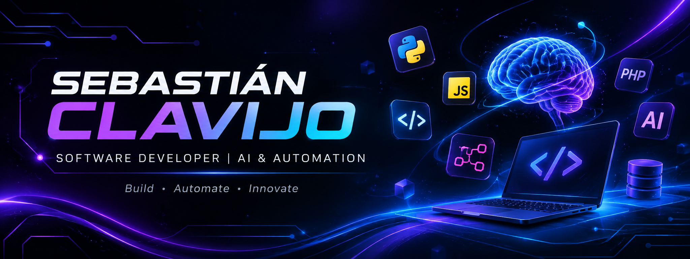
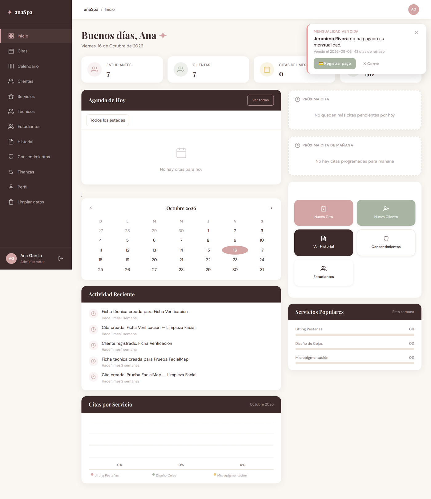

  <picture>
    <source srcset="assets/banner-tuyo.webp" type="image/webp" />
    
  </picture>

  
  
  

---

Diseño y construyo **sistemas de gestión a la medida** para pequeñas y medianas empresas: SaaS, POS y ERP que reemplazan el Excel y el cuaderno. Trabajo con **Django y PostgreSQL**, despliego en servidores Linux propios y uso IA donde de verdad ahorra trabajo — no donde solo se ve bonito.

Fundé **Gamora Systems**, con base en Medellín.

## Stack con el que trabajo

  
  
  
  
  
  
  
  
  
  

## Proyectos

### AesthetiCare — SaaS multi-tenant para estudios de estética

Gestión completa de un estudio: citas, clientas, servicios, historial clínico y consentimientos informados.

Lo interesante no es la interfaz, es el aislamiento: **cada estudio vive en su propio esquema de PostgreSQL** (`django-tenants`), resuelto desde la sesión y no desde el subdominio. Un estudio no puede ver los datos de otro ni por error. Cada uno además personaliza sus colores, y esos ajustes persisten entre sesiones porque el middleware de tenant corre antes de la autenticación.

  

`Django` · `PostgreSQL` · `django-tenants` · `CSS vanilla` — **privado**, demo en vivo disponible a pedido.

---

### Balance — finanzas de negocio registradas desde Telegram

SaaS de control financiero. La particularidad es cómo se ingresa un gasto: le escribes al bot, le mandas una nota de voz o le tomas una foto al recibo.

El bot transcribe el audio con **Whisper en local** y parsea el texto con **Claude Haiku**; de la foto saca monto, fecha y comercio por OCR. Cada usuario tiene uno o varios negocios con finanzas completamente separadas.

`Django 5` · `PostgreSQL` · `python-telegram-bot` · `faster-whisper` · `Claude Haiku` — **privado**, demo a pedido.

---

### Orión — plataforma de gestión para un centro de formación

Sistema que cubre los **33 requisitos funcionales** de la especificación de un centro de formación del SENA, con chatbot integrado en la interfaz.

`Django 5` · `PostgreSQL` · `Tailwind CSS` · `Playwright` — **privado**.

---

### ReqAI — de la reunión con el cliente a los requisitos

App móvil en Flutter: grabas la reunión, la app transcribe el audio con Whisper vía Groq, y extrae **requisitos funcionales estructurados** que se convierten en tareas. Nació de un problema real: las reuniones de levantamiento se pierden en notas sueltas.

`Flutter` · `Dart` · `Supabase` · `Groq` · `OpenRouter`

  

---

### KanView — API y panel para un taller de tapicería en cuero

API con Django REST Framework —vistas basadas en funciones, sin capas de abstracción innecesarias— más las páginas de interfaz servidas con templates.

`Django REST Framework` · `PostgreSQL`

  

## Cómo trabajo

- **Django + PostgreSQL por defecto.** SQLite solo para prototipos. No elijo la tecnología por moda: elijo la que voy a poder mantener en dos años.
- **Despliegue real en Linux.** Systemd con Gunicorn y Nginx sirviendo estáticos, con HTTPS. No entrego un proyecto que solo corre en `runserver`.
- **Los archivos no viven en el servidor.** Fotos y documentos van a almacenamiento S3-compatible (Backblaze B2) detrás de Cloudflare. En producción, `MEDIA_ROOT` local es una bomba de tiempo.
- **Seguridad desde el día uno.** `django-axes` contra fuerza bruta, CSP y cabeceras endurecidas, validación en el backend. El frontend nunca es la única capa.
- **Cada proyecto se documenta.** Arquitectura, decisiones y por qué se tomó cada una, en Markdown dentro del repo. Es lo primero que leo cuando vuelvo a un proyecto de hace seis meses.

## Contacto

¿Tienes un proceso que todavía se lleva en Excel, en papel o por WhatsApp? Escríbeme y lo miramos.

**contacto@gamorasystems.com** · [gamorasystems.com](https://gamorasystems.com) · Medellín, Colombia
